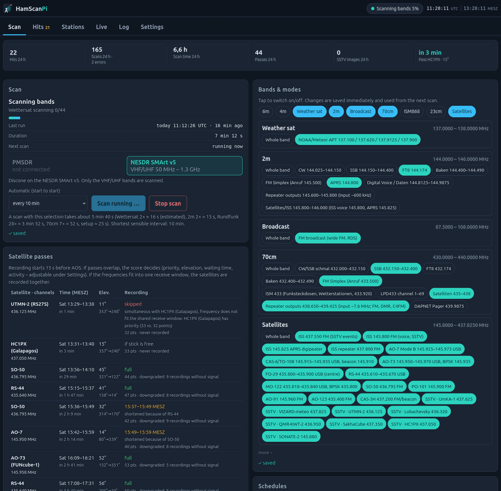
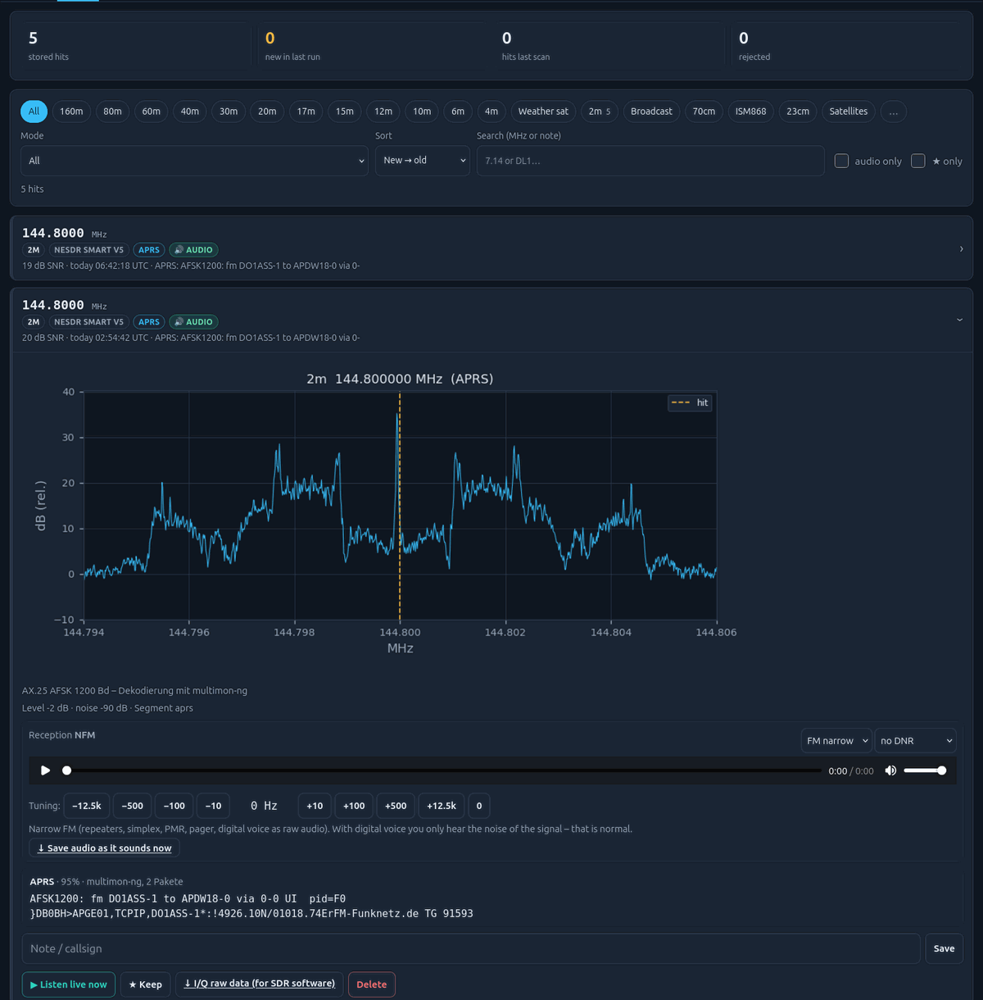
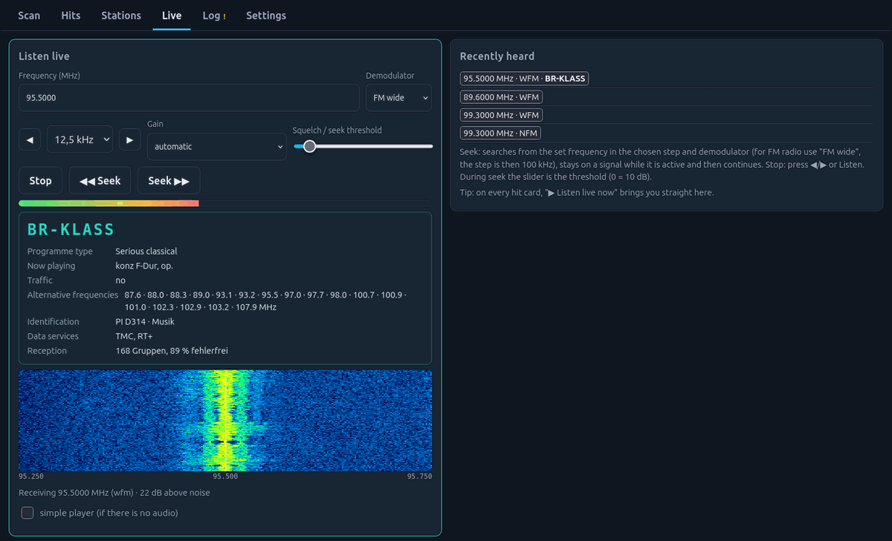
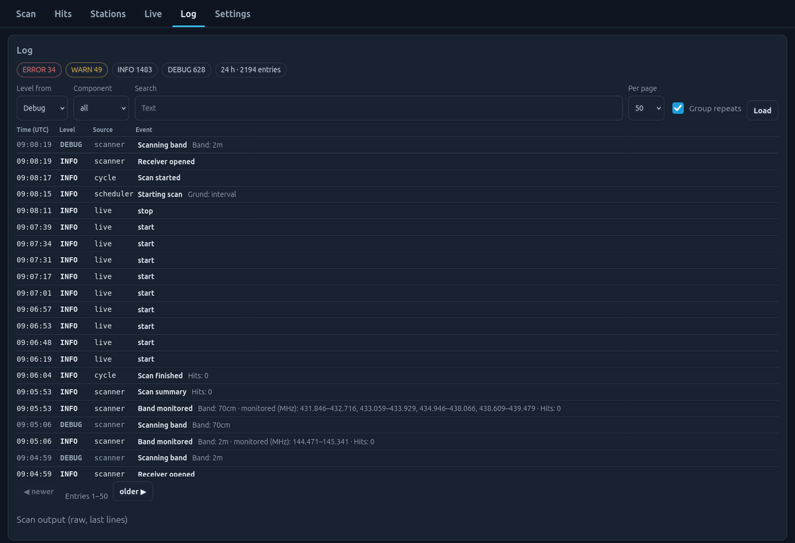
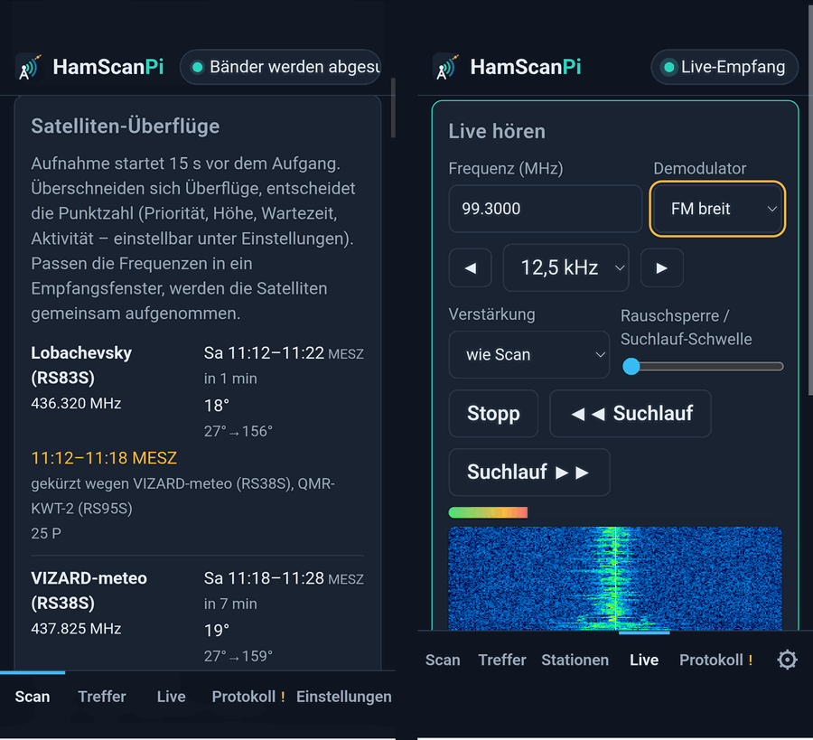
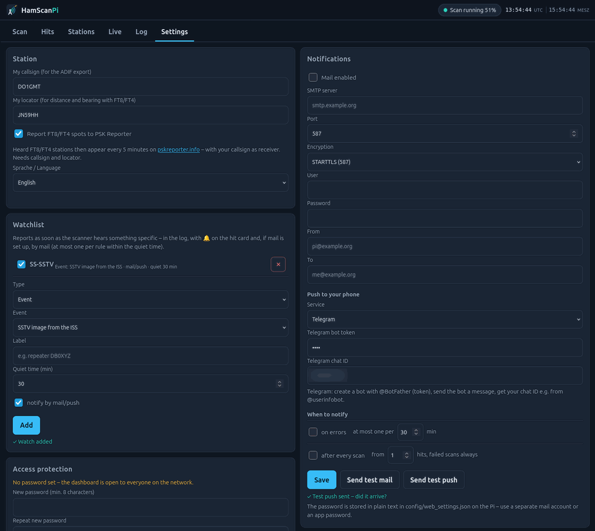
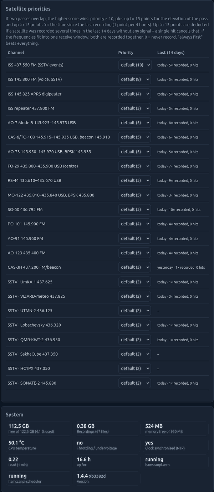
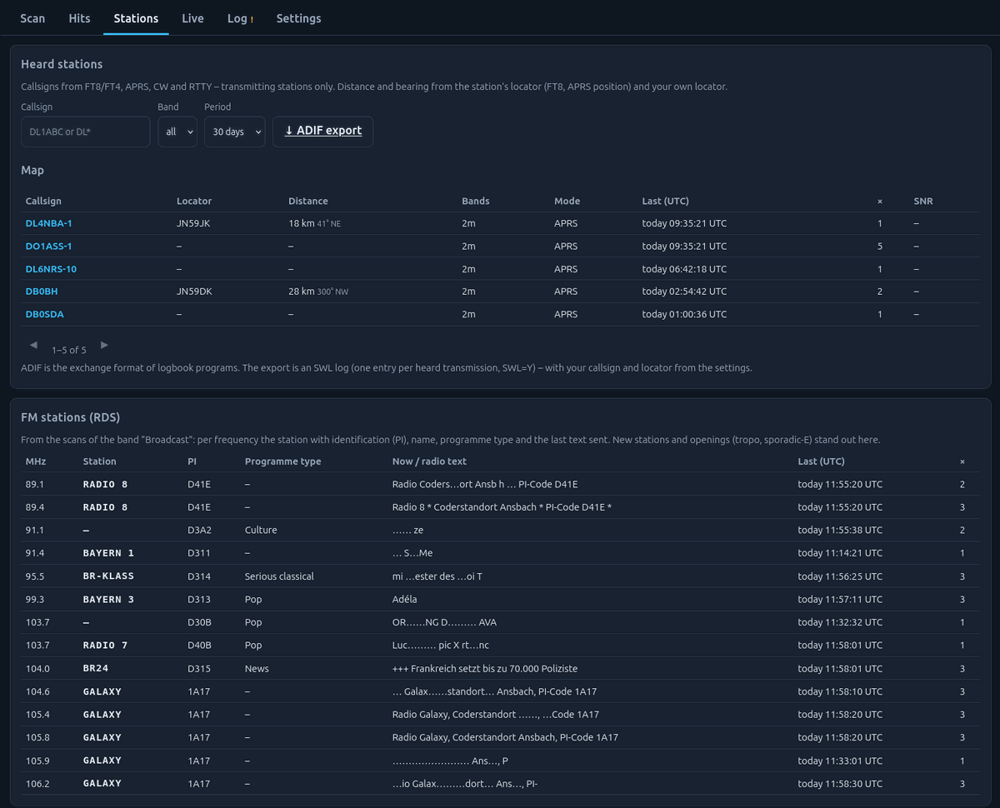
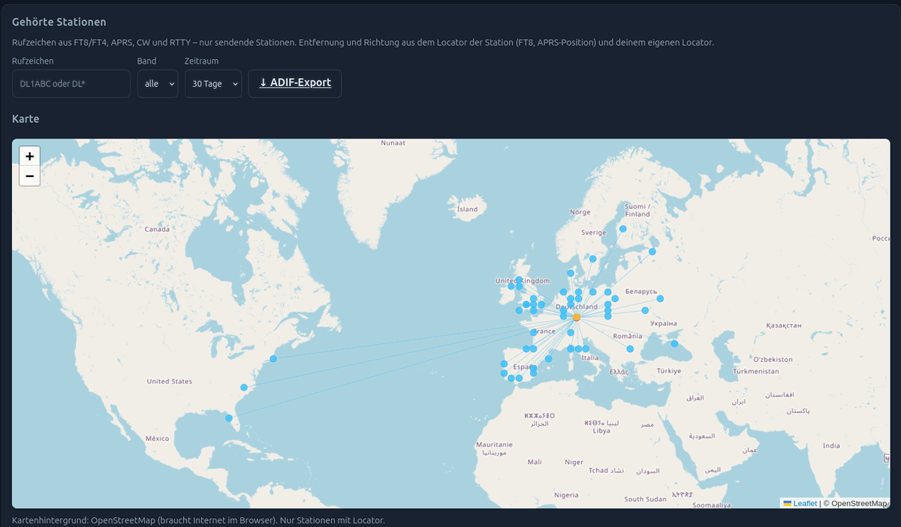
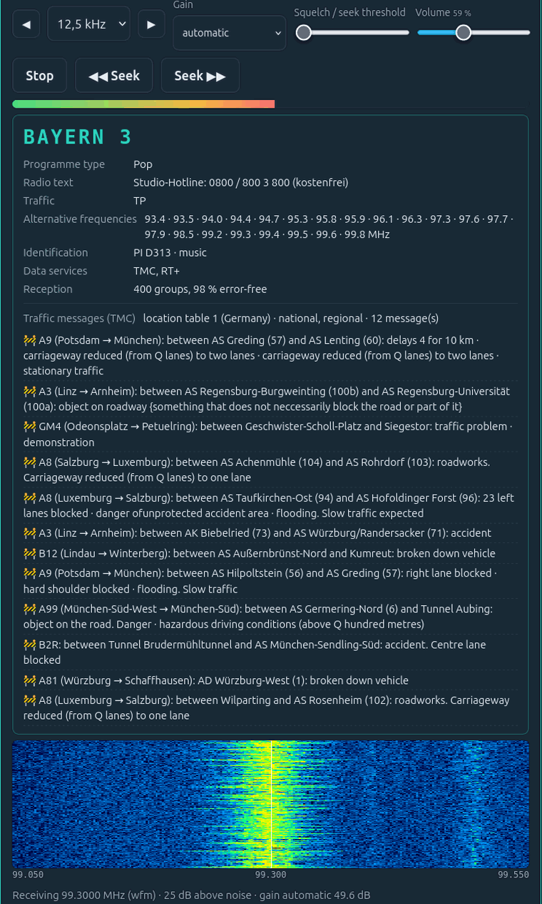

# HamScanPi

*Hams can Pi.*

[](https://github.com/do1gmt/hamscanpi/actions/workflows/selftest.yml)

**An unattended band scanner and satellite recorder for radio amateurs, running on a Raspberry Pi.**

HamScanPi scans the amateur bands on its own, records what it hears, decodes what it can and shows
everything in a web dashboard you open on your phone or PC. When an amateur satellite passes overhead
it interrupts the scan, follows the Doppler shift and records the pass – including SSTV images from
the ISS and from CubeSats.

It works with an RTL-SDR stick (VHF/UHF, satellites) and optionally with a
PMSDR receiver (IW3AUT) for shortwave.



> **Status:** works daily on the author's station (Raspberry Pi, RTL-SDR, PMSDR).
> The dashboard speaks **English and German** – switch under *Settings → Station*. Missing
> translations live in `web/i18n.js`; pull requests are welcome.

## What it does

**Band scanning**
- Scans the bands you select (160 m … 23 cm, plus 11 m CB, PMR446, Freenet, broadcast, weather satellites).
  Bands that may not be monitored in many countries are disabled by default – see [Legal](#legal).
  The band plan follows IARU Region 1 and lives in `config/scanner.json`.
- Every hit is stored with its I/Q recording, spectrum and audio. Listen in the browser, retune in
  10 Hz steps (SSB), switch sideband, apply noise reduction, add notes, protect hits from clean-up.
- Decoders: **FT8/FT4** (via [ft8_lib](https://github.com/kgoba/ft8_lib)), **CW**, **RTTY**,
  **APRS** and **POCSAG** (via multimon-ng), **SSTV** on shortwave (14.230, 21.340, 28.680 USB,
  3.730 and 7.165 LSB) – including images whose start was missed and stations that are off-frequency.
- Live listening with waterfall (tap to tune), seek function, signal-to-noise display and overload warning.
- FM broadcast with RDS: station name, radio text, artist/title (RT+), clock, alternative frequencies –
  live and for every scanned station (list of FM stations).
- TMC traffic messages from RDS in plain text (road, direction, between which junctions, event,
  duration) using the German location table – live, on hit cards and as watchlist alerts ("A9").
- Band schedules: other bands by time of day and weekday.
- On repeaters and FM channels the scanner stays until the QSO ends and records it as a whole.

**Stations and alerts**
- *Stations* tab: every transmitting callsign from FT8/FT4, APRS, CW and RTTY with locator, distance,
  bearing and last heard – exportable as an ADIF SWL log.
- Watchlist: alerts for a frequency, a callsign (`DL*`), DX beyond N km or events such as SSTV from
  the ISS – in the log, on the hit card, by mail or as push to your phone (ntfy, Telegram).
- Map of heard stations, activity overview by band and hour, optional reporting of FT8/FT4 spots
  to [PSK Reporter](https://pskreporter.info).

**Satellites (RTL-SDR)**
- Switched on and off with the band chip *Satellites*; passes are only recorded while the RTL-SDR is the
  selected receiver – the selected receiver stands for the antenna that is connected (one antenna
  at a time, e.g. via an antenna switch). With the chip off, satellites never interrupt a scan.
- Orbital elements from CelesTrak (fallback: AMSAT), pass prediction with SGP4 from your locator.
- Recording starts 15 s before AOS; the Doppler shift is corrected every 0.1 s per channel.
- ISS: SSTV on 437.550 and 145.800 MHz, the 437.800 FM repeater, the 145.825 APRS digipeater.
- FM and linear-transponder satellites (SO-50, AO-123, AO-91, PO-101, AO-7, FO-29, RS-44, MO-122, …)
  and SSTV CubeSats (UmKA-1, VIZARD-meteo, Lobachevsky, QMR-KWT-2, SONATE-2, …).
- SSTV decoder: Robot 36/72, Martin 1/2, Scottie 1/2/DX, PD 90–290.
- **Scheduling:** when passes overlap, a score decides (priority × 10, elevation, time since the
  satellite was last recorded, and a penalty for satellites that stayed silent for many passes).
  If the frequencies of simultaneous passes fit into one receive window, up to three satellites are
  recorded **together**, each with its own Doppler correction.

**Dashboard**
- Scan, hits, live, log and settings – mobile first, no page reloads.
- Scan history with paging, a readable event log, scan duration estimate, adjustable scan raster,
  satellite priorities, mail notifications.

## Screenshots

| | |
|---|---|
|  |  |
| Hit card: spectrum, audio with tuning and noise reduction, decoded APRS packets | Live listening: FM broadcast with RDS (station, programme type, RT+, AF) and waterfall |
|  |  |
| Event log with the monitored frequencies of every scan | On the phone (here with the German UI) |
|  |  |
| Settings: station (ADIF, PSK Reporter), watchlist, mail and push notifications | Satellite priorities with the last 14 days, system status of the Pi |


*Stations: callsigns heard via APRS/FT8/CW with locator, distance and bearing (ADIF export); FM stations with RDS name, PI, programme type and radio text.*


*Map of heard stations (one evening of FT8 scans on 80–20 m with an HF-360 vertical): lines from the own locator, up to 7,900 km.*



*Live FM reception with RDS and TMC traffic messages in plain text (German location table of BASt).*

## Hardware

| Part | Notes |
|---|---|
| Raspberry Pi 4 or 5 | 2 GB RAM or more. A Pi 3 works for scanning, satellite recording with several channels may be too slow. |
| RTL-SDR stick | any RTL2832U stick (RTL-SDR Blog V3/V4, Nooelec NESDR, …) – VHF/UHF and satellites |
| Antenna | a discone or a vertical works for strong passes; a turnstile or QFH is better for satellites |
| PMSDR (optional) | shortwave 160–10 m, needs a USB sound card for I/Q and its control program – see [docs/pmsdr.md](docs/pmsdr.md) |

## Installation

```bash
git clone https://github.com/do1gmt/hamscanpi.git
cd hamscanpi
./install.sh            # optional: ./install.sh 8081 for another port
```

The installer sets up the packages, the RTL-SDR driver blacklist, the local configuration and two
systemd services (`hamscanpi-web`, `hamscanpi-scheduler`). Then open `http://<pi-address>:8080/`
and enter your locator under *Settings → Station*.

Update later with `bin/update.sh` – it pulls the new version, completes your local configuration and
restarts the services. The dashboard shows a notice under *Settings → System* when a new version is out.
Changes are listed in [CHANGELOG.md](CHANGELOG.md).

### Files

| Path | Content |
|---|---|
| `config/scanner.default.json` | default band plan and receiver settings (copied to `config/scanner.json` on first start) |
| `config/scanner.json` | your local copy – PPM correction, gain, antenna names (`antennas`), sound card, `allow_restricted_bands` |
| `config/web_settings.json` | dashboard settings, locator, mail account (**contains your SMTP password, never commit it**) |
| `config/auth.json` | dashboard password (hashed) and trusted networks – never committed |
| `data/`, `recordings/`, `reports/`, `log/` | database, I/Q recordings, images and decodes, logs |

## Access protection

By default the dashboard is open to everyone who can reach it. Set a password under
*Settings → Access protection* (or during `./install.sh`). Then every device has to log in once
(session cookie, 30 days); after 5 wrong passwords an address is blocked for 5 minutes. You can
list networks that need no login, e.g. your home network `192.168.178.0/24`. The Pi itself
(localhost) never needs to log in.

Forgot the password? On the Pi: `python3 bin/auth.py set` (or `python3 bin/auth.py off`).

> If you make the dashboard reachable from the internet, put it behind HTTPS (e.g. a reverse proxy
> or a VPN such as WireGuard/Tailscale). The built-in server speaks plain HTTP. Behind a reverse
> proxy every request comes from the proxy's address, so do not list that address as trusted.

## Data sources

- Orbital elements: [CelesTrak](https://celestrak.org) (fallback: AMSAT).
- TMC traffic messages: *Location Code List* LCL 22.0 and *Event Code List* ECL 4.01 of the
  Bundesanstalt für Straßenwesen (BASt), licensed under [CC BY 4.0](https://creativecommons.org/licenses/by/4.0/);
  converted to `share/tmc/` (see the README there).

## Legal

HamScanPi only receives. Which transmissions you may listen to, record and decode depends on the
law of your country.

### Restricted bands

Bands whose reception is forbidden in many countries – such as the **airband** – are marked
`"legal": "restricted"` in the band plan. **By default they are switched off completely:** they do
not appear in the dashboard, are never scanned, live listening and the seek function skip them,
and old hits from these bands are hidden.

Only where the law of your country allows it, you can enable them in `config/scanner.json`:

```json
"allow_restricted_bands": true
```

They then appear under *more* (German UI: *weitere*), marked with ⚠. In **Germany** listening to the airband is not
allowed (§ 5 TDDDG, formerly TTDSG) – leave the setting at `false` there. You are responsible for
the bands you enable.

## Testing without hardware

`devtools/selftest.sh` runs the satellite and SSTV chain against simulated signals (ISS pass with
Doppler, three satellites in one recording, APRS, shortwave SSTV) in a temporary copy – your own
installation is not touched. See [docs/testing.md](docs/testing.md).

## Credits

- Pass prediction: [sgp4](https://pypi.org/project/sgp4/) · orbital elements: [CelesTrak](https://celestrak.org), [AMSAT](https://www.amsat.org)
- FT8/FT4: [ft8_lib](https://github.com/kgoba/ft8_lib) by Karlis Goba, YL3JG
- APRS/POCSAG: [multimon-ng](https://github.com/EliasOenal/multimon-ng)
- Satellite frequencies and status: AMSAT, ARISS, SatNOGS DB

## License

GNU General Public License v3.0 – see [LICENSE](LICENSE).
