# HamScanPi

*Hams can Pi.*

[](https://github.com/do1gmt/hamscanpi/actions/workflows/selftest.yml)

**An unattended band scanner and satellite recorder for radio amateurs, running on a Raspberry Pi.**

HamScanPi scans the amateur bands on its own, records what it hears, decodes what it can and shows
everything in a web dashboard you open on your phone or PC. When an amateur satellite passes overhead
it interrupts the scan, follows the Doppler shift and records the pass – including SSTV images from
the ISS and from CubeSats.

It works with an RTL-SDR stick – VHF/UHF and satellites, and shortwave too with sticks that have direct
sampling (e.g. Nooelec NESDR SMArt v5, RTL-SDR Blog V3) – and optionally with a PMSDR receiver (IW3AUT) for
shortwave.

**Quick start** on a fresh Raspberry Pi OS Lite: `sudo apt install -y git`, then
`git clone https://github.com/do1gmt/hamscanpi.git && cd hamscanpi && ./install.sh`, re-plug the stick and open
`http://hamscanpi.local:8080/` – details under [Installation](#installation).

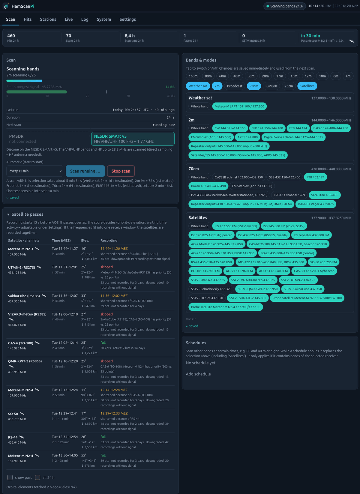

> **Status:** works daily on the author's station (Raspberry Pi, RTL-SDR, PMSDR).
> The dashboard speaks **English and German** – switch under *Settings → Station*. Missing
> translations live in `web/i18n.js`; pull requests are welcome.

## What it does

**Band scanning**
- Scans the bands you select (160 m … 23 cm, plus 11 m CB, PMR446, Freenet, broadcast, weather satellites).
  Bands that may not be monitored in many countries are disabled by default – see [Legal](#legal).
  The band plan follows IARU Region 1 and lives in `config/scanner.json`.
- Every hit is stored with its I/Q recording, spectrum and audio. Listen in the browser, retune in
  10 Hz steps (SSB), switch sideband, apply noise reduction, add notes, protect hits from clean-up.
- Decoders: **FT8/FT4** (via [ft8_lib](https://github.com/kgoba/ft8_lib)), **CW**, **RTTY**,
  **APRS** and **POCSAG** (via multimon-ng), **SSTV** on shortwave (14.230, 21.340, 28.680 USB,
  3.730 and 7.165 LSB) – including images whose start was missed and stations that are off-frequency.
- Live listening with waterfall (tap to tune), seek function, signal-to-noise display and overload warning;
  live decoders also for **NAVTEX** (518/490/4209.5 kHz), **weather fax** (charts as images, e.g. DWD Pinneberg)
  and **weather RTTY** (450/850 Hz shift), chosen automatically by frequency.
- **Shortwave broadcasting with the [EiBi](http://www.eibispace.de/) schedule:** in Live the station on the tuned
  frequency and a list of everything on air now (tap to listen); as chip *EiBi* in the scan a check of every
  scheduled broadcast with carrier level – a log of what was heard per band.
- FM broadcast with RDS: station name, radio text, artist/title (RT+), clock, alternative frequencies –
  live and for every scanned station (list of FM stations).
- TMC traffic messages from RDS in plain text (road, direction, between which junctions, event,
  duration) using the German location table – live, on hit cards and as watchlist alerts ("A9").
- Band schedules: other bands by time of day and weekday.
- On repeaters and FM channels the scanner stays until the QSO ends and records it as a whole.

**Stations and alerts**
- *Stations* tab: every transmitting callsign from FT8/FT4, APRS, CW and RTTY with locator, distance,
  bearing and last heard – exportable as an ADIF SWL log.
- Watchlist: alerts for a frequency, a callsign (`DL*`), DX beyond N km or events such as SSTV from
  the ISS – in the log, on the hit card, by mail or as push to your phone (ntfy, Telegram).
- Map of heard stations (per callsign or per locator square, fine zoom), overview per station,
  activity overview by band and hour, optional reporting of FT8/FT4 spots to [PSK Reporter](https://pskreporter.info).
- FT8/FT4 decodes on the network in the **WSJT-X UDP format** – for OpenHamClock, GridTracker, JTAlert & co.

**Satellites (RTL-SDR)**
- Switched on and off with the band chip *Satellites*; passes are only recorded while the RTL-SDR is the
  selected receiver – the selected receiver stands for the antenna that is connected (one antenna
  at a time, e.g. via an antenna switch). With the chip off, satellites never interrupt a scan.
- Orbital elements from CelesTrak (fallback: AMSAT), pass prediction with SGP4 from your locator.
- Recording starts 15 s before AOS; the Doppler shift is corrected every 0.1 s per channel.
- ISS: SSTV on 437.550 and 145.800 MHz, the 437.800 FM repeater, the 145.825 APRS digipeater.
- FM and linear-transponder satellites (SO-50, AO-123, AO-91, PO-101, AO-7, FO-29, RS-44, MO-122, …)
  and SSTV CubeSats (UmKA-1, VIZARD-meteo, Lobachevsky, QMR-KWT-2, SONATE-2, …).
- SSTV decoder: Robot 36/72, Martin 1/2, Scottie 1/2/DX, PD 90–290.
- **Scheduling:** when passes overlap, a score decides (priority × 10, elevation, time since the
  satellite was last recorded, and a penalty for satellites that stayed silent for many passes).
  If the frequencies of simultaneous passes fit into one receive window, up to three satellites are
  recorded **together**, each with its own Doppler correction.

**Dashboard**
- Scan, hits, live, log and settings – mobile first, no page reloads.
- Scan history with paging, a readable event log, scan duration estimate, adjustable scan raster,
  satellite priorities, mail and push notifications (also when the Pi gets a new IP address or network).
- Hits: "new in last run" counts the hits of the last completed run; tapping it (or the number on the *Hits*
  tab) shows only those, "show all hits" goes back.
- Antenna profiles, automatic backups, a rescue page and a diagnostics package for when something goes wrong.

## Screenshots

| | |
|---|---|
| 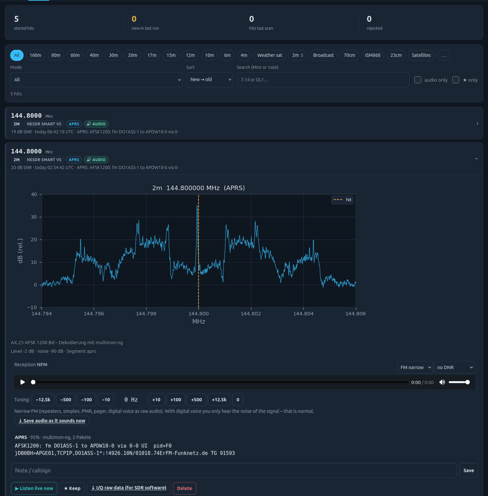 | 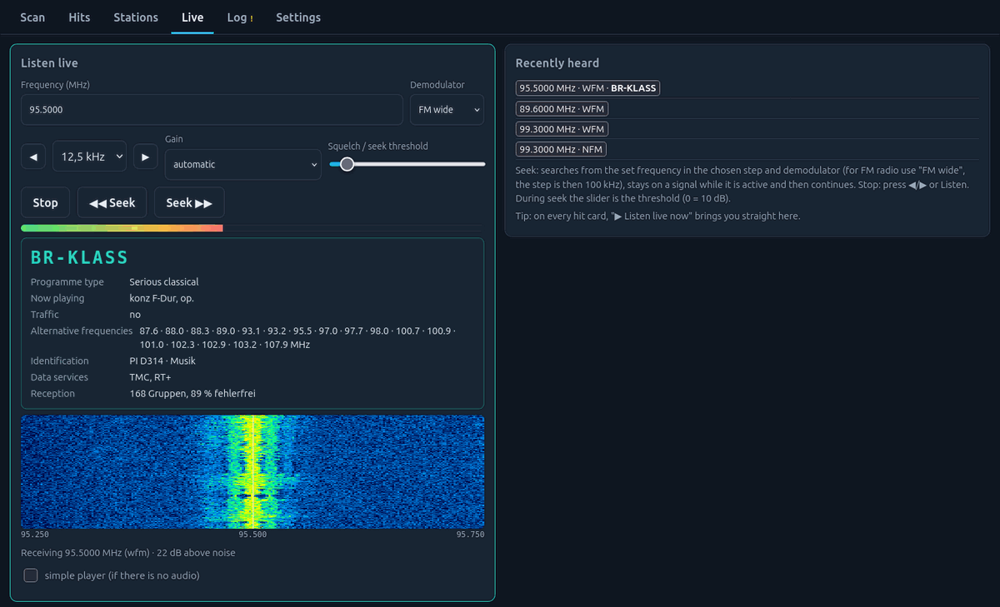 |
| Hit card: spectrum, audio with tuning and noise reduction, decoded APRS packets | Live listening: 10 m FT8 via the stick (direct sampling) with level meter, waterfall and live decodes (FT8/FT4, APRS, POCSAG, CW, RTTY, SSTV) |
| 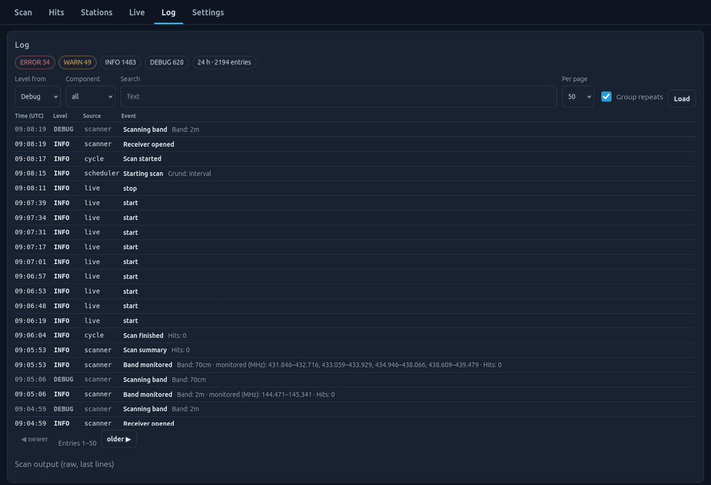 | 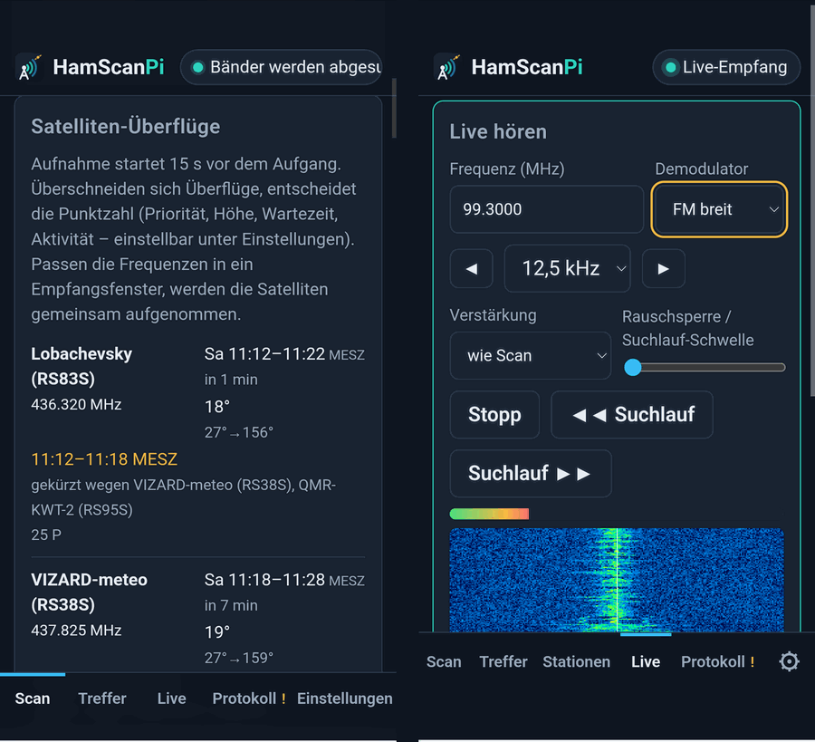 |
| Event log with the monitored frequencies of every scan | On the phone (here with the German UI) |
| 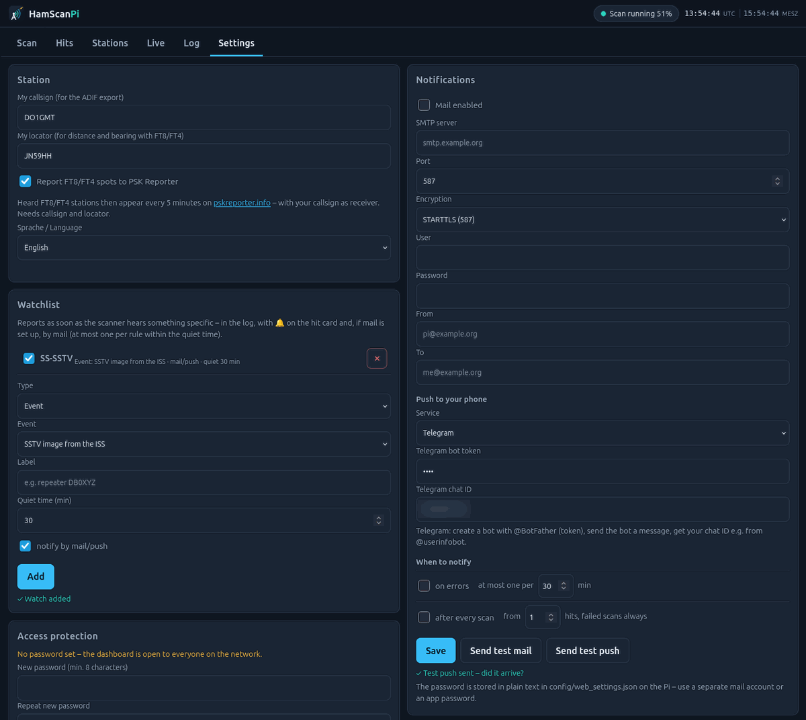 | 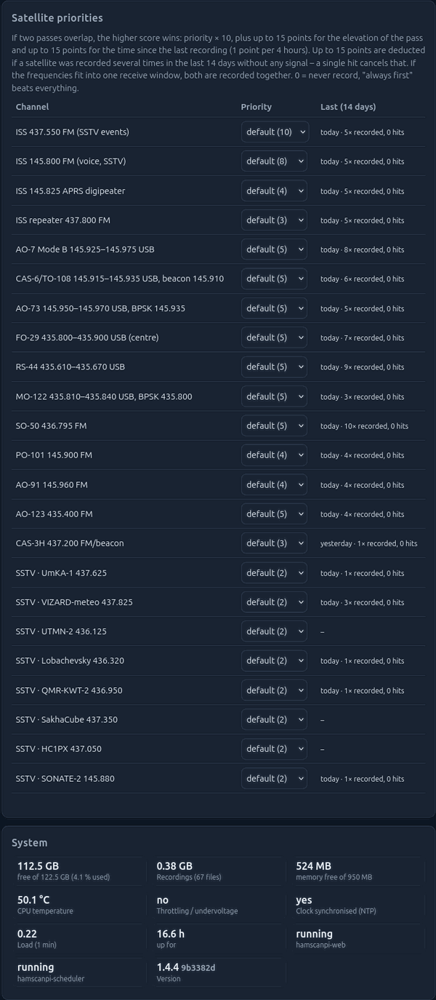 |
| Settings: station (ADIF, PSK Reporter), watchlist, mail and push notifications | Satellite priorities with the last 14 days, system status of the Pi |

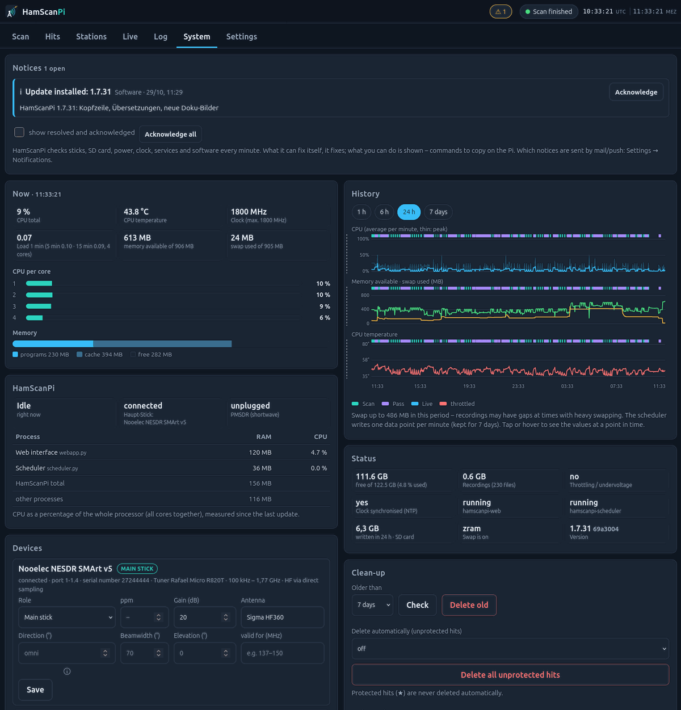
System page: notices with what to do, live values and 24-hour history (CPU, memory/zram, temperature),
status (storage, write load, swap, services, version) and the device register – here an NESDR SMArt v5 that
also covers HF via direct sampling.

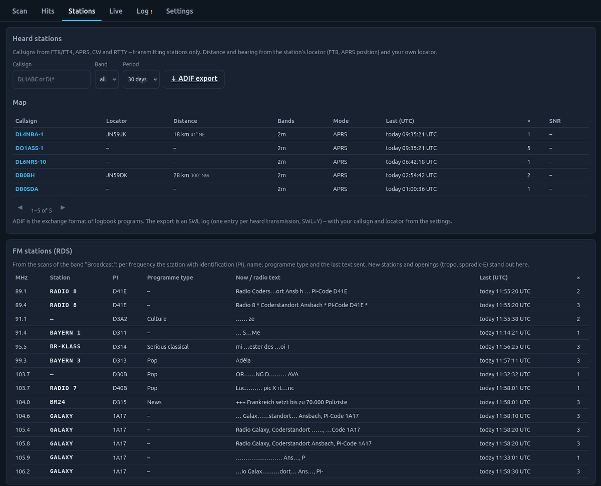
*Stations: callsigns heard via APRS/FT8/CW with locator, distance and bearing (ADIF export); FM stations with RDS name, PI, programme type and radio text.*

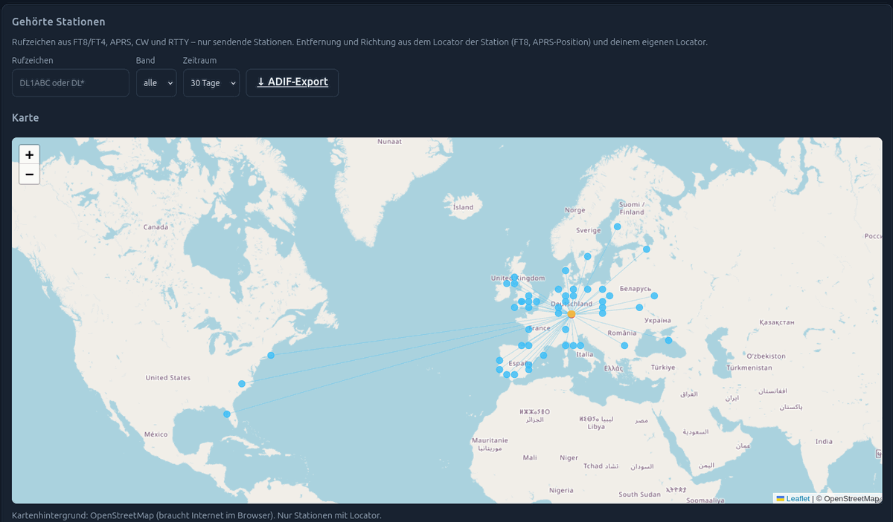
*Map of heard stations (one evening of FT8 scans on 80–20 m with an HF-360 vertical): lines from the own locator, up to 7,900 km; point colour = SNR, border = mode.*

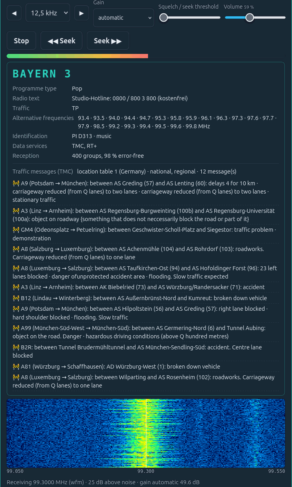

*Live FM reception with RDS and TMC traffic messages in plain text (German location table of BASt).*

## Hardware

| Part | Notes |
|---|---|
| Raspberry Pi 4 or 5 | 2 GB RAM or more. A Pi 3 works for scanning, satellite recording with several channels may be too slow. |
| RTL-SDR stick | any RTL2832U stick (RTL-SDR Blog V3/V4, Nooelec NESDR, …) – VHF/UHF and satellites |
| Antenna | a discone or a vertical works for strong passes; a turnstile or QFH is better for satellites |
| PMSDR (optional) | shortwave 160–10 m, needs a USB sound card for I/Q and its control program – see [docs/pmsdr.md](docs/pmsdr.md) |

**Stations:** every heard callsign is kept (FT8/FT4, APRS, CW, RTTY – scan and Live), nothing is deleted. The full
record (`heard`, one row per reception) stays for ADIF and details; a summary per callsign (`station`) is kept up
to date on every new entry, so the list and the map stay fast with hundreds of thousands of entries (measured:
300 000 receptions of 20 000 callsigns – list 0.01 s, map 0.07 s, filtered by period and band 0.2 s on a PC). The
map shows all stations whose locator is known, independent of the list page, for the period, band and search
chosen above (periods from 30 minutes to 1 year or everything). It shows either one point per **callsign**
(colour = SNR, border = mode) or the **locator squares** (4-character, 2° × 1°, stronger = more stations);
details appear on mouse-over or tap; zoom in half steps (buttons) or quarter steps (wheel, pinch) up to level 15. A station is placed in the locator square it sent **most often** (a single
decoding error or a portable trip does not move it). **Open station** (search field, a callsign in the list or a
point on the map) shows everything collected for one callsign: receptions, first/last heard, best SNR, every
locator sent with count, period and an example message, bands and modes, and every single reception with message,
antenna and a link to the hit.

**Memory:** HamScanPi runs on a Pi 4 with 1 GB RAM. Recordings are analysed piece by piece (mixed to the hit
frequency and reduced to 12 kHz while reading, in single precision), so even 120 s shortwave recordings need
only a few dozen MB. If a recording still cannot be analysed, it is skipped and logged instead of filling the
memory.

**EiBi in the scan:** like "Satellites", "EiBi" is a chip under *Bands & modes*; its segments are the broadcast
meter bands (120 m … 11 m). When it is on, every scan – after the normal bands – checks the broadcasts EiBi lists
as on air at that moment: they are grouped into windows (at most 30 kHz apart, never tuned exactly onto a carrier
because of the receiver's DC residue), each window is recorded for 3 s and the carrier level of every broadcast is
measured against the noise floor; from 15 dB (adjustable) it counts as heard. Results go to their own log
(`eibi_log`, not the hit list); the card *Shortwave broadcasting in the scan* shows the last check (station,
transmitter with distance, SNR, ✓) and per band how many were heard in the last 24 h – a propagation picture.
Options: max. windows per scan, threshold, only broadcasts targeting Europe/global. Tapping a row tunes Live to it
in AM. Works with the PMSDR or the stick (direct sampling up to 28.8 MHz).

**Utility decoders in Live:** besides FT8/FT4, APRS, POCSAG, CW, RTTY and SSTV, Live decodes **NAVTEX**
(SITOR-B, 518/490/4209.5 kHz: CCIR 476 with the FEC repetition, complete messages `ZCZC … NNNN` with station,
subject and number appear as their own entries), **weather fax** (HF fax 120 lpm/IOC 576, e.g. DWD Pinneberg
3855/7880/13882.5 kHz; start tone, phasing and stop tone are detected, the chart grows in the list and is saved as
PNG) and **weather RTTY** with 450/850 Hz shift (DWD 50 Bd). In "automatic" the decoder is chosen by frequency
(NAVTEX, DWD fax/RTTY, Northwood fax). Tune in USB, the dial about 1.9 kHz (fax) or 1.5 kHz below the listed
frequency.

**Shortwave broadcast schedule (EiBi):** in Live, below the frequency, HamScanPi shows what the
[EiBi](http://www.eibispace.de/) schedule (Eike Bierwirth, free to use) lists **on air right now** on that
frequency (±5 kHz): station, language, target area, transmitter site with distance, until when – the most likely
one first (exact frequency, target area Europe, nearest transmitter), others below. The card **"Shortwave – on air
now"** lists everything currently scheduled in the broadcast bands (120 m … 11 m), filterable by band, language,
country and station; tapping a row tunes Live to it in AM. The schedule (`sked-<season>.csv` plus `README.TXT`
for languages, countries and transmitter sites) is fetched automatically at the season change (A = summer from
the last Sunday in March, B = winter from the last Sunday in October) and every 14 days; if the new season's list
is not published yet, the latest/previous one is used; without internet the last fetched list stays in use. Both
files can also be uploaded by hand (Live → "Manage list").

**Share decodes on the network (WSJT-X protocol):** under *Settings → Station → Share on the network* every FT8/FT4
decode (scan and Live) is sent as UDP packets in the WSJT-X "UDP Server" format (heartbeat, status with dial
frequency, decode) – **OpenHamClock**, GridTracker, JTAlert and other programs show the stations HamScanPi hears.
Targets: `host:port`, several separated by commas, port usually 2237; a multicast group such as `224.0.0.1:2237`
can be heard by several programs at once. For OpenHamClock on another computer set `HOST=0.0.0.0` there (and
`WSJTX_MULTICAST_ADDRESS` when using multicast). Sending runs in the background: without a network nothing waits,
an unreachable target is logged once (`wsjtx_udp_failed` / `wsjtx_udp_resumed`), decodes of the last 2 minutes
are sent afterwards, older ones are dropped (useless for a live display). "Save and send test packet" checks a
target right away.

**Which channels of a satellite are recorded:** if not all selected channels fit into one receive window (e.g.
ISS 2 m and 70 cm), HamScanPi takes the group with the best chance of a signal – priority × chance. The chance
starts from experience (Meteor LRPT always on, linear transponder beacons almost always, the ISS APRS digipeater on
145.825 mostly, FM repeaters only when someone talks, SSTV only during announced events) and is then replaced
step by step by what was actually heard on that channel in the last 30 days. Fixed carriers on the ground show up
in the Doppler-corrected waterfall as a mirrored Doppler curve; from 3.5 dB they are recognised and remembered as
interference lines instead of counting as a satellite signal.

**Satellites – horizon and minimum elevation** (Settings → Satellite priorities): *Horizon* is the elevation
below which terrain or buildings hide the sky, the same all around (0–30°, default 0°): only the part of a pass
above it is recorded, passes that never get above it are dropped. *Only passes reaching at least …* (10–60°,
default 10°): lower passes stay greyed out in the list ("too low") and are not recorded.

**Spare stick and restoring on other hardware:** a stick with the role *spare* steps in when the main stick is
missing (only if exactly one spare is plugged in) – with its own gain, ppm, antenna and shortwave setting; a notice
says so, and the main stick is used again as soon as it is back. New, not yet assigned sticks never step in.
Restoring a backup from another Pi: if the main stick of the backup is not plugged in but exactly one other stick is,
that one becomes the main stick (the old one stays registered as spare).

**Antenna profiles:** under *System → Devices → Antennas* (a collapsible section at the top of the card – edit the
fields in place, "+ Antenna" adds one, ✕ deletes, then "Save") each antenna is created once (name, frequency range,
and for directional antennas direction, beamwidth, elevation – the existing entries become the first profiles).
When switching antennas, just choose the profile in the scan box ("Antenna ▾") or at the main stick / HF receiver
– it is saved immediately, the pass planning uses its range and beam, and the change is logged. Editing a profile
updates the receivers that use it; changing the fields by hand turns the profile off for that stick.

**Scans and satellite passes share the stick.** A scan is only started if it will be finished before the next
important pass (estimated from the longest recent scans and the estimate for the current band selection). If a
pass still needs the stick, the scanner is asked to give it up (`data/scan_yield`): it stops between two steps
or inside a long recording within a second or two, keeps what it found, and the analysis runs afterwards
without the stick – the pass is already recording meanwhile. Only if it does not respond within 20 s is the run
ended by force and leftover `rtl_sdr` processes cleaned up. A pass that is already more than half over does not
interrupt a scan. A scan without a sign of life for 10 minutes is ended and reported. After switching on
"Satellites" or changing the satellite selection or priorities, no pass starts for **60 seconds** (countdown
with a "now" button in the pass list), so looking around or choosing satellites does not throw out a running
scan.

**Taking the Pi elsewhere:** the dashboard (8080) and the rescue page (8081) listen on all interfaces, so in another
network it is reachable at the address it gets by DHCP – and as **`http://hamscanpi.local:8080`**: the service
`hamscanpi-mdns` announces that name via avahi with the current address, whatever the Pi's host name is (the host
name itself is not changed; if another device already uses the name, this Pi stays reachable as
`<hostname>.local` and a notice says so). Windows 10/11, macOS, iOS and Linux resolve `.local` names; Android
does not reliably – use the IP address there (it is in the push message). In a **different network** (other
gateway) the dashboard asks on the next visit, until answered, whether the locator is still right ("Still right" /
"Save").
When the IP address or the network changes (judged by the gateway and its hardware address, confirmed by two checks
a minute apart), HamScanPi shows a notice "New network: <IP>" / "New IP address: <IP>" with the links and sends it
by mail/push (event "New network / new IP address", on by default; without internet it is sent as soon as there is
one). In a different network it also asks whether the locator still fits. Note: trusted networks of the access
protection do not apply in a foreign network (the password is asked), and guest networks with client isolation
can block access from other devices.

**When something hangs:** the web server checks itself every 30 s and the scheduler reports every 10 s to
systemd's watchdog – if one of them stops responding for 3 or 5 minutes, systemd restarts it (shown as a notice).
Memory limits per service (web 500 MB, scheduler with scans and analysis 750 MB) make an outlier hit only its
own service instead of the whole Pi. *System → Services* shows the services and restarts them or the Pi; if the
dashboard itself does not answer, the **rescue page** on port 8081 (`http://<pi>:8081`, a separate tiny service,
same password) does the same and shows memory and the latest log lines. Restarting needs root: the update
installs `/etc/sudoers.d/hamscanpi`, which allows exactly `systemctl --no-block restart hamscanpi-web |
hamscanpi-scheduler | hamscanpi-rescue` and `systemctl reboot` – nothing else (checked with `visudo` first).
*Download diagnostics* (dashboard or rescue page, or `python3 bin/diag.py`) packs logs (including the output of
the scan runs and the scheduler), kernel and service messages of the last 2 days, the system history, which
processes hold the scan locks, and the settings without credentials into one file.
If a requested scan cannot start because the receiver or a run is still busy, the scan box says so with the
process holding the lock (`scan_start_rejected` in the log; `python3 bin/lockinfo.py` shows it any time); a
request that has not started after 3 minutes is reset, so the dashboard never stays at "Scan requested 0 %".

**Band plan by country:** *Settings → Station → Country / band plan* selects the band plan used for scanning and
classifying hits. **Germany (IARU Region 1)** is the default and unchanged. **Austria**, **Switzerland** and the **United Kingdom** (Region 1) and **Canada** (Region 2) are
available as well (Freenet only in Germany, no 4 m in Austria, UK 4 m 70.0–70.5 MHz, UK 60 m allocations and CB
27/81, Canada like the US without MURS and with 70 cm 430–450 MHz). For the US and Canada FM broadcast uses
**RBDS** (North American programme types, station call sign from the PI code). **USA (IARU Region 2)** follows the
ARRL band plan: 160–10 m with US edges (80 m to 4.0, 40 m to 7.3 MHz), the 60 m channels and the 5351.5–5366.5 kHz
segment, 6 m to 54 MHz, 2 m to 148 MHz with APRS on 144.390, simplex 146.520 and repeaters with −600/+600 kHz,
1.25 m, 70 cm 420–450 MHz with ±5 MHz repeaters, 33 cm, 23 cm repeaters, FRS/GMRS, MURS, NOAA Weather Radio,
ISM 915 MHz, FM broadcast 87.9–107.9 MHz, and the airband as a normal band. The locator suggests a country. The
profile is a data file (`bandplans/us.json`, overlay over `config/scanner.json`, which stays unchanged); more
countries can be added the same way – pull requests welcome.

**Shortwave without a PMSDR:** sticks with direct sampling on the Q branch (Nooelec NESDR SMArt v5, RTL-SDR
Blog V3) also receive 100 kHz – 28.8 MHz. HamScanPi recognises them (*System → Devices*: "HF via direct
sampling"), switches direct sampling on below 24 MHz (Live and scan; the driver's syntax `-D` / `-D 2` /
`-E direct2` is detected automatically) and then offers the HF bands for the stick as well – the same voice,
FT8/FT4, CW/RTTY and SSTV detection as with the PMSDR. There is no gain control in this mode, and an HF antenna
(long wire, dipole) has to be connected to the stick. The RTL-SDR Blog V4 needs the Blog driver for HF.

## Installation

**You need:** a Raspberry Pi 4 or 5 (a Pi 3 works, but slowly) with **Raspberry Pi OS Lite, 64 bit** (Debian 12
"bookworm" or 13 "trixie"; a desktop is not needed), a user with sudo rights (the one created in Raspberry Pi
Imager), network (cable recommended, Wi-Fi works) and an RTL-SDR stick. Set user, password, Wi-Fi and SSH in the
Imager before writing the card, then log in by SSH.

**1. Bring the system up to date and install git** (git is not part of the Lite image):
```bash
sudo apt update && sudo apt full-upgrade -y
sudo apt install -y git
```

**2. Get HamScanPi and install it:**
```bash
git clone https://github.com/do1gmt/hamscanpi.git
cd hamscanpi
./install.sh            # asks once for the language (Deutsch / English); ./install.sh --lang de asks nothing
                        # another port: ./install.sh --port 8090 (the rescue page uses port + 1)
```
The installer asks only for the language – messages and the dashboard are set to it – and takes a few minutes.
Everything it sets up on the system is in `bin/setup_system.sh`, which runs again on every update. It
- installs the Debian packages: Python with numpy, scipy, matplotlib, Pillow, soundfile, sgp4; `rtl-sdr` (programs
  and USB access for the stick – **no separate driver is needed**), `multimon-ng` (APRS, POCSAG), sqlite3,
  alsa-utils, avahi (name in the network), build tools and `iw`;
- blacklists the DVB-T TV driver of the kernel that would otherwise grab the stick;
- builds **ft8_lib** for FT8/FT4 (shortwave, 6 m, 2 m, 70 cm) in `~/ft8_lib`;
- creates `config/scanner.json` and `config/web_settings.json`;
- gives the stick access rights (udev rule `/etc/udev/rules.d/20-hamscanpi-rtlsdr.rules` – without it `rtl_sdr`
  reports `usb_open error -3`);
- installs the services `hamscanpi-web` (dashboard, port 8080), `hamscanpi-scheduler` (scans, satellite passes),
  `hamscanpi-rescue` (rescue page, port 8081), `hamscanpi-mdns` (name `hamscanpi.local`) and `hamscanpi-update`
  (the update button);
- adds a sudo rule for exactly the dashboard buttons (restart services, start the update, reboot), keeps the
  system journal across reboots (max. 64 MB) and switches Wi-Fi power saving off (otherwise Live stutters over
  Wi-Fi).

If the PMSDR control program `/usr/local/bin/pmsdr` exists, its service is set up as well (see
[docs/pmsdr.md](docs/pmsdr.md)).

**3. Re-plug the stick** (or reboot) – until then the old TV driver may still hold it.

**4. Open the dashboard:** `http://hamscanpi.local:8080/` or `http://<IP-of-the-Pi>:8080/` (Android phones often do
not resolve `.local` – use the IP there; `hostname -I` on the Pi shows it). Then, all in the dashboard:
- *Settings → Station*: locator, callsign, language, country/band plan;
- *Settings → Access protection*: a password (recommended – without it everyone in your network can use it);
- *System → Devices*: make the stick the **main stick** (it is recognised by its serial number);
- *Settings → Notifications*: mail or push, if wanted;
- choose bands and satellites on the *Scan* page and start a scan.

**Check the installation** (optional): `bash devtools/selftest.sh` runs about 40 checks against simulated signals
in a temporary copy – your installation is not touched. Everything it needs is installed or bundled.

**Updates** come from GitHub: *System → Status → "Update now"* in the dashboard, or `bin/update.sh` by SSH. Both
wait until no scan and no satellite pass is running, pull the new version (`git pull`), run `bin/setup_system.sh`
(new packages, services, rules, configuration) and restart the services; the output is shown in the dashboard and
kept in `log/update.log`. Settings, data and recordings stay. The dashboard checks GitHub once a day and shows
when a new version is out. Changes are listed in [CHANGELOG.md](CHANGELOG.md).

*Updating an older installation for the first time this way* (before 1.7.76 `bin/update.sh` did not set up the
system yet): `cd ~/hamscanpi && git pull && bin/update.sh` – from then on the button works.

*Maintainers* publish a version from a PC with git and a GitHub SSH key: `bash hamscanpi-publish.sh` (built with
`devtools/build_publish.sh`) clones or updates a working copy next to it, replaces its files with the new version,
commits, tags `v<version>` and pushes; nothing personal can get into the repository (checked before the commit).

### Files

| Path | Content |
|---|---|
| `config/scanner.default.json` | default band plan and receiver settings (copied to `config/scanner.json` on first start) |
| `config/scanner.json` | your local copy – PPM correction, gain, sound card, `allow_restricted_bands`; HF receiver name and antenna are set under *System → Devices* (stored here as `device_labels`/`antennas`), the antenna of each RTL stick in its device entry |
| `config/web_settings.json` | dashboard settings, locator, mail account (**contains your SMTP password, never commit it**) |
| `config/auth.json` | dashboard password (hashed) and trusted networks – never committed |
| `data/`, `recordings/`, `reports/`, `log/` | database, I/Q recordings, images and decodes, logs |

## SD card or SSD

HamScanPi itself runs the same on both – same paths, same behaviour. The difference is wear, speed and power.

HamScanPi runs around the clock and writes recordings, its database, the system history and logs.
*System → Status* shows how much was written to the system drive in the last 24 hours (and the daily
average), whether it is an SD card, USB drive or NVMe SSD, and where the swap lives.

| | SD card | SSD (USB) |
|---|---|---|
| Wear from continuous writing | the weak point – a normal card lasts roughly 1–3 years of 24/7 use, *endurance* cards (dashcam grade) much longer | many times more durable |
| Speed (database, evaluation, hit list, boot) | adequate | noticeably faster |
| Power loss | often loses its file system | usually survives better |
| Power draw | none extra | extra from the Pi's USB – with RTL stick, PMSDR and sound card use the official 5.1 V/3 A supply or a powered adapter/hub; *System → Status* reports undervoltage |
| Radio interference | none | USB 3 radiates broadband noise: SSD on a blue USB 3 port with a short, well-shielded cable, RTL stick on a black USB 2 port with an extension, as far away as possible – then check the noise floor in *Live* |

A few hundred MB written per day is fine for a good card for years; several GB per day make an SSD
worthwhile.

### Swap

Raspberry Pi OS Trixie already uses **zram** (swap compressed in RAM) – nothing is swapped to the card:

```
swapon --show            # /dev/zram0 only? Then zram is active – nothing to do.
```

On older systems with a swap file on the card, install zram with the swap file kept as a low-priority reserve
(only written when zram is full):

```
sudo apt install -y zram-tools
printf 'ALGO=zstd\nPERCENT=50\nPRIORITY=100\n' | sudo tee /etc/default/zramswap
sudo systemctl restart zramswap
swapon --show            # /dev/zram0 with priority 100, the swap file below it
```

If zram is full and there is no reserve, the kernel has to end a process – the system history shows the
largest process per minute to find the cause.

### Backup and restore

*System → Backup* downloads everything important as one file – settings; optionally with the data (hits,
stations, FM stations, interference lines, system history) and the recordings (audio, I/Q, waterfalls,
images, can be large). The databases are copied consistently even while a scan is writing. *Include
credentials* (on by default) also stores the mail password and Telegram/ntfy token in plain text – keep the
file safe. To restore, upload the file in the same card: HamScanPi shows what is in it, restores as soon as
no scan or pass is running, moves the current settings and data to `restore-previous/<time>/` first, adds
recordings (never deletes them) and restarts its services.

**Automatic backup:** in the same card, a backup can be written daily or weekly at a chosen hour to a USB stick
(appears under `/media/<user>/…`) or a mounted network share (e.g. `/mnt/nas`, mounting example in the card),
keeping the last N files. A target on the SD card itself is refused – it would not help if the card fails.
A failed backup becomes a notice.

From the command line, e.g. after losing the card (fresh install, then):

```
python3 bin/backup.py create --scope data          # settings | data | all, --no-secrets, -o file
python3 bin/backup.py info hamscanpi-backup-….tar.gz
python3 bin/backup.py restore hamscanpi-backup-….tar.gz
sudo systemctl restart hamscanpi-scheduler hamscanpi-web
```

### Moving to an SSD

Boot the **whole system** from the SSD (Raspberry Pi 4 and 5 can do this directly) rather than putting only
HamScanPi on it – then logs and everything else live on the SSD too, and the services never start before
their drive is mounted.

1. Write Raspberry Pi OS to the SSD with the Raspberry Pi Imager (same user name as before, e.g. `gmt`).
2. Shut the Pi down, remove the SD card, connect the SSD to a blue USB 3 port and boot.
3. Install HamScanPi as described under *Installation* (`install.sh`).
4. Stop the services and copy your data from the old card (in a USB card reader, here mounted at `/media/$USER/rootfs`):
   ```
   sudo systemctl stop hamscanpi-scheduler hamscanpi-web
   OLD=/media/$USER/rootfs/home/$USER/hamscanpi
   cp -a $OLD/config/. ~/hamscanpi/config/       # settings, band plan, passwords, Telegram
   cp -a $OLD/data/. ~/hamscanpi/data/           # database, stick register, history, satellite results
   cp -a $OLD/recordings $OLD/reports ~/hamscanpi/   # only if you want to keep the old hits
   sudo systemctl start hamscanpi-scheduler hamscanpi-web
   ```
5. Check *System → Devices* (main stick still recognised by its serial number) and *System → Status*
   (drive now "USB drive").

Keep the old card as an emergency spare – put it back in and the Pi starts as before.

## Access protection

By default the dashboard is open to everyone who can reach it. Set a password under
*Settings → Access protection* (or during `./install.sh`). Then every device has to log in once
(session cookie, 30 days); after 5 wrong passwords an address is blocked for 5 minutes. You can
list networks that need no login, e.g. your home network `192.168.178.0/24`. The Pi itself
(localhost) never needs to log in.

Forgot the password? On the Pi: `python3 bin/auth.py set` (or `python3 bin/auth.py off`).

> If you make the dashboard reachable from the internet, put it behind HTTPS (e.g. a reverse proxy
> or a VPN such as WireGuard/Tailscale). The built-in server speaks plain HTTP. Behind a reverse
> proxy every request comes from the proxy's address, so do not list that address as trusted.

## Data sources

- Orbital elements: [CelesTrak](https://celestrak.org) (fallback: AMSAT).
- TMC traffic messages: *Location Code List* LCL 22.0 and *Event Code List* ECL 4.01 of the
  Bundesanstalt für Straßenwesen (BASt), licensed under [CC BY 4.0](https://creativecommons.org/licenses/by/4.0/);
  converted to `share/tmc/` (see the README there).

## Legal

HamScanPi only receives. Which transmissions you may listen to, record and decode depends on the
law of your country.

### Restricted bands

Bands whose reception is forbidden in many countries – such as the **airband** – are marked
`"legal": "restricted"` in the band plan. **By default they are switched off completely:** they do
not appear in the dashboard, are never scanned, live listening and the seek function skip them,
and old hits from these bands are hidden.

Only where the law of your country allows it, you can enable them in `config/scanner.json`:

```json
"allow_restricted_bands": true
```

They then appear under *more* (German UI: *weitere*), marked with ⚠. In **Germany** listening to the airband is not
allowed (§ 5 TDDDG, formerly TTDSG) – leave the setting at `false` there. You are responsible for
the bands you enable.

## Testing without hardware

`devtools/selftest.sh` checks about 40 areas against simulated signals and fake receivers – satellite passes
with Doppler, SSTV, FT8, APRS, RDS/TMC, NAVTEX, weather fax, EiBi, the scan/satellite/live sharing of the stick,
backups, notifications – in a temporary copy; your own installation is not touched. See
[docs/testing.md](docs/testing.md).

## Credits

- Pass prediction: [sgp4](https://pypi.org/project/sgp4/) · orbital elements: [CelesTrak](https://celestrak.org), [AMSAT](https://www.amsat.org)
- FT8/FT4: [ft8_lib](https://github.com/kgoba/ft8_lib) by Karlis Goba, YL3JG
- APRS/POCSAG: [multimon-ng](https://github.com/EliasOenal/multimon-ng)
- Satellite frequencies and status: AMSAT, ARISS, SatNOGS DB

## License

GNU General Public License v3.0 – see [LICENSE](LICENSE).
